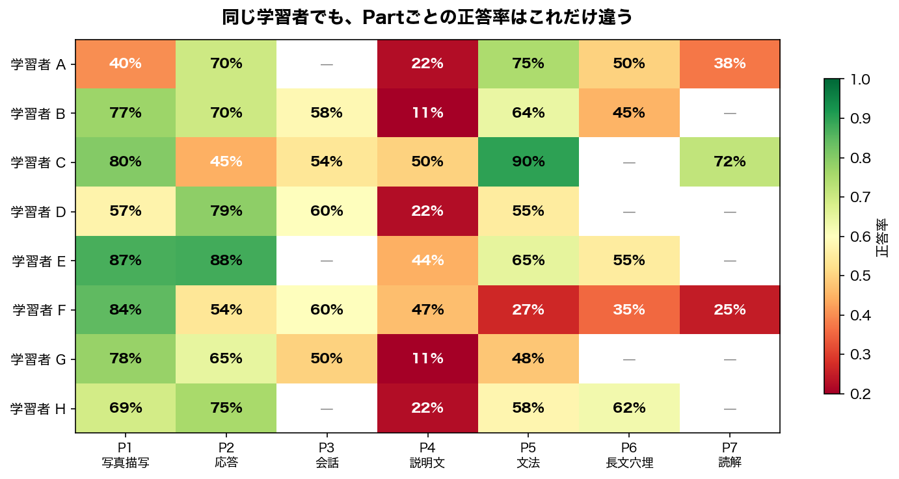

# Adaptive Learning with Knowledge Tracing

EdNet の実データ（78万ユーザー・1.3億インタラクション）を使い、**Knowledge Tracing → Item Selection** のパイプラインを設計・実装する実験。

## 問い

> テスト対策アプリで、次に何を出せば一番効果的か？

その第一段として、**古典モデル（IRT 2PL・BKT）で推定した学習者の知識状態は、出題戦略の入力として十分か** を確かめる（[02](notebooks/02-irt-bkt.qmd)）。

## 結論

- 同じ学習者の前半 70% で推定して後半 30% を予測すると（within-user）、AUC-ROC は IRT 2PL 0.571、BKT 0.618。スキル別の習熟を時系列で追う BKT の方が高い
- 未知の学習者（user-level split、cold-start）では IRT 0.556、BKT 0.566 で、ほぼコンセプトの難易度だけで当てている状態。古典モデルは新規ユーザーの個人化ができない
- それでも IRT の難易度・識別力と BKT の learn rate は「問題側の情報」として新規ユーザーの出題に使える。深層 KT（03）と出題戦略（04）はまだ着手していない

数値は 5,000 ユーザーのサンプル（約55万行）での1回の実行。詳細と図はノートブック [02](notebooks/02-irt-bkt.qmd) の 5〜6 節。

## 再現手順

lab-experiments のルートで依存を入れ、この実験フォルダでデータ取得・テスト・レンダリングを行う。データ（EdNet-KT1）は `data/` に置かれ、git 管理外。

```bash
# リポジトリのルートで
uv sync --package adaptive-learning-kt

# この実験フォルダで
cd adaptive-learning/2026-04-21-kt-ednet
make download                                # EdNet-KT1 を data/raw/ に取得
make test                                    # pytest
make render FILE=notebooks/02-irt-bkt.qmd    # Quarto → HTML（_site/、git 管理外）
```

IRT の MCMC 推論に 10〜20 分かかる。2回目以降は `_freeze/` の計算済み出力を使う。

## ノート

lab-research-notes：未作成

## 背景

```
従来の学習アプリ                    アダプティブラーニング
─────────────────                   ─────────────────────
全員に同じ問題を順番に出す          学習者ごとの知識状態を推定し出題

学習者A ─→ Q1, Q2, Q3, Q4 ...      学習者A ─→ 文法が苦手
学習者B ─→ Q1, Q2, Q3, Q4 ...        → 文法の中難度問題を優先
学習者C ─→ Q1, Q2, Q3, Q4 ...      学習者B ─→ リスニングが苦手
     (一律)                           → リスニング強化問題を出題

結果: 簡単すぎ/難しすぎの問題に      結果: 各学習者の「伸びしろ」に
      時間を浪費                          集中して学習できる
```

問題の本質は **学習者ごとにスキル別の知識状態が異なるのに、それを無視して一律に出題していること** にある。正答率だけで難易度を調整しても、「文法は得意だがリスニングは苦手」という構造は捉えられない。

実際にデータを見ると、このばらつきは明らかだった。



学習者Cは文法90%だが応答45%。学習者Gは写真描写78%だが説明文11%。**同じ人の中でもスキルごとの得意・不得意がこれだけ違う**のに、全員に同じ問題を順番に出しても意味がない。

Knowledge Tracing (KT) は、解答履歴からスキルごとの習熟度がどう変化しているかを推定する技術で、KT の出力があれば **Zone of Proximal Development** — 難しすぎず易しすぎないちょうどいい領域 — に問題を合わせられる。

## Architecture

Computerized Adaptive Testing (CAT) の枠組みに沿って、2段階のパイプラインで構成する。

```
学習者の解答ログ
       │
       ▼
┌─────────────────────────────────────────────────────┐
│                                                      │
│  Knowledge Tracing — 知識状態の推定                   │
│  ┌─────────────┐  ┌──────────────────────────────┐  │
│  │ IRT 2PL     │  │ DKT / SAKT / SimpleKT        │  │
│  │ BKT         │  │ (PyTorch Lightning)           │  │
│  │ (説明可能性)│  │ (予測精度)                    │  │
│  └─────────────┘  └──────────────────────────────┘  │
│           │                    │                     │
│           ▼                    ▼                     │
│  Item Selection — 出題戦略                           │
│  ┌───────────────────────────────────────────────┐  │
│  │ Random / Difficulty Matching / Thompson Smpl   │  │
│  └───────────────────────────────────────────────┘  │
│                                                      │
└─────────────────────────────────────────────────────┘
       │
       ▼
  次の一問
```

## ノートブック

| # | 問い | 手法 | 状態 |
|---|------|------|------|
| [01](notebooks/01-eda.qmd) | 学習者はどう行動しているか？ | Polars, Matplotlib | 済 |
| [02](notebooks/02-irt-bkt.qmd) | 学習者の「知識」を測れるか？ | PyMC (IRT 2PL), pyBKT | 済 |
| 03 | Deep Learning で精度は上がるか？ | PyTorch Lightning, MLflow | 未着手 |
| 04 | 「次の一問」をどう選ぶか？ | シミュレーション | 未着手 |

## 構成

```
├── notebooks/           # Quarto (.qmd) — 分析ノートブック
├── src/
│   ├── data/            # ダウンロード・ローダ・サンプリング
│   ├── features/        # 前処理パイプライン (elapsed_time クリッピング、系列長フィルタ等)
│   ├── models/
│   │   ├── irt.py       # IRT 2PL (PyMC)
│   │   └── bkt.py       # BKT wrapper (pyBKT)
│   └── eval/            # AUC, calibration, metrics
├── tests/               # pytest
├── assets/              # README の図
├── _freeze/             # Quarto の計算済み出力
└── data/{raw,processed} # git 管理外
```

## Dataset

**EdNet-KT1**: ~780K users, ~130M interactions, 188 skill tags, TOEIC Part 1–7.
本プロジェクトでは 5,000 ユーザーをサンプリング (~550K rows)。

[Paper](https://arxiv.org/abs/2002.08038) / [GitHub](https://github.com/riiid/ednet)

## Tech Stack

| カテゴリ | ライブラリ |
|---------|-----------|
| データ処理 | Polars, Matplotlib |
| 古典モデル | PyMC (IRT 2PL), pyBKT |
| 深層学習 | PyTorch, Lightning |
| 実験管理 | MLflow |
| 環境 | Python 3.11, uv, Quarto |

## References

**データセット**
- Choi et al. (2020). *EdNet: A Large-Scale Hierarchical Dataset in Education*. L@S. [arXiv:2002.08038](https://arxiv.org/abs/2002.08038)

**古典モデル (02-irt-bkt)**
- Corbett & Anderson (1994). *Knowledge Tracing: Modeling the Acquisition of Procedural Knowledge*. UMUAI.

**深層モデル (03-deep-kt)**
- Piech et al. (2015). *Deep Knowledge Tracing*. NeurIPS.
- Pandey & Karypis (2019). *A Self-Attentive model for Knowledge Tracing*. EDM.
- Liu et al. (2023). *SimpleKT: A Simple But Tough-to-Beat Baseline for Knowledge Tracing*. ICLR.

**出題戦略 (04-item-selection)**
- Clement et al. (2015). *Multi-Armed Bandits for Intelligent Tutoring Systems*. JEDM.
- Ghosh et al. (2021). *BOBCAT: Bilevel Optimization-Based Computerized Adaptive Testing*. IJCAI.

## License

MIT
